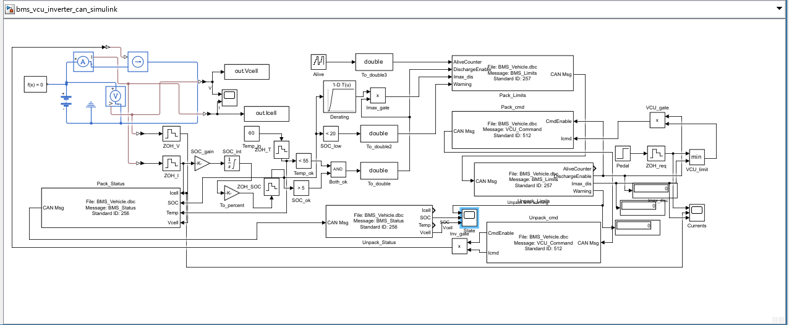
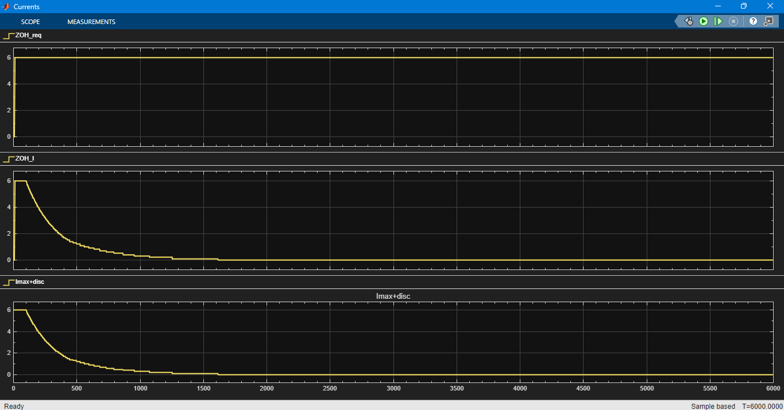
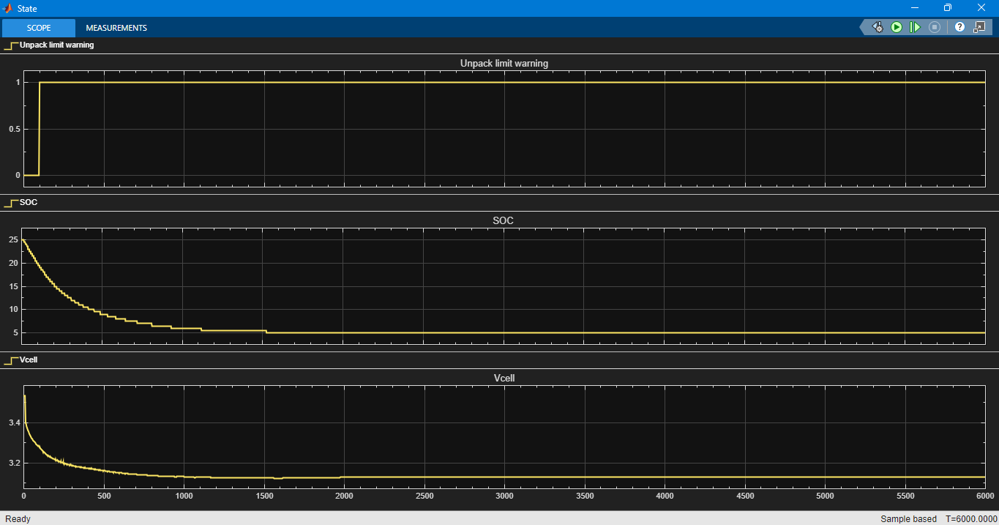
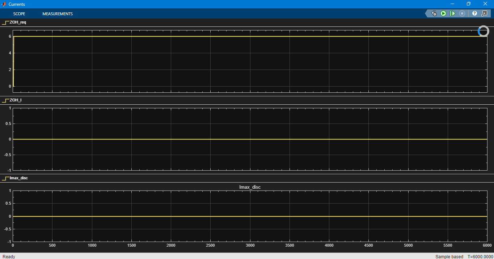
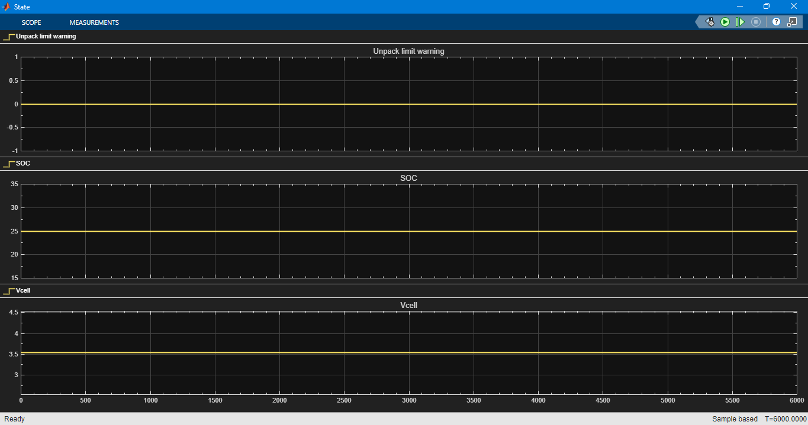

# BMS, VCU and Inverter Data Exchange over CAN (MATLAB/Simulink)

Three nodes share one CAN bus: a **BMS** reports battery state and discharge limits, a **VCU** limits the driver's power request to the BMS limit, and an **inverter** draws only the commanded current from a 2RC Li-ion cell. As SOC falls, the BMS derates the allowed current and the actual current follows it down, even though the driver keeps asking for full power.



## Key idea
The driver's pedal is a **request**, not a command. The VCU never exceeds the BMS discharge limit, because the BMS knows the cell's SOC and temperature and the VCU does not.

## System
```
Cell (2RC) --V, I--> BMS --0x100 BMS_Status, 0x101 BMS_Limits--> VCU --0x200 VCU_Command--> Inverter --current--> Cell
```

| Node | Role |
|---|---|
| **BMS** | Samples voltage, current and temperature every 0.1 s, estimates SOC by coulomb counting, computes the discharge limit from a derating map, sets DischargeEnable and Warning, and sends an alive counter |
| **VCU** | Takes the smaller of the driver's current request and the BMS limit, gates it with DischargeEnable, and sends the command to the inverter |
| **Inverter** | Receives the command and draws that current from the battery (ideal current source) |
| **Cell** | Table-based Simscape battery with two RC pairs (fast and slow polarization) |

## CAN messages (`BMS_Vehicle.dbc`)
| Message | ID | Sender | Signal | Scaling |
|---|---|---|---|---|
| BMS_Status | 0x100 | BMS | Vcell | 0.001 V, unsigned 16-bit |
| | | | Icell | 0.1 A, signed 16-bit (positive = discharge) |
| | | | SOC | 0.5 %, unsigned 8-bit |
| | | | Temp | 1 degC, offset -40, unsigned 8-bit |
| BMS_Limits | 0x101 | BMS | Imax_dis | 0.1 A, unsigned 16-bit |
| | | | DischargeEnable | 0 / 1 |
| | | | Warning | 0 = none, 1 = low SOC derating |
| | | | AliveCounter | 8-bit rolling counter |
| VCU_Command | 0x200 | VCU | Icmd | 0.1 A, unsigned 16-bit |
| | | | CmdEnable | 0 / 1 |

Standard 11-bit IDs, 8 bytes, little-endian, one message every 100 ms. Three messages at 500 kbit/s is about 0.7 % bus load.

## Derating map
| SOC | Allowed discharge current |
|---|---|
| above 20 % | 6 A (2C) |
| 20 % to 10 % | linear ramp, 6 A to 1.5 A |
| 10 % to 5 % | linear ramp, 1.5 A to 0 A |
| below 5 % | 0 A |

Discharge is also disabled when the temperature is 55 degC or higher.

## Parameters
| Item | Value |
|---|---|
| Cell capacity | 3 Ah |
| R0 | 0.02 ohm |
| R1 / tau1 | 0.015 ohm / 30 s |
| R2 / tau2 | 0.010 ohm / 300 s |
| OCV table | SOC [0 0.2 0.5 0.8 1.0] -> [3.0 3.5 3.7 4.0 4.2] V |
| Initial SOC | 25 % |
| Driver request | 6 A, applied at t = 10 s |

## Test 1: SOC derating




- The driver request stays at 6 A for the whole run.
- SOC reaches 20 % at about 100 s. Warning goes to 1 and the BMS limit starts falling along the derating map.
- The actual current follows the BMS limit, not the request, and reaches about 0 A at roughly 1600 s.
- SOC settles at 5 %, where the derating map reaches 0 A, so the cell is never discharged below it.
- Cell voltage drops from 3.53 V to about 3.4 V when the load starts (I x R0), sags further as the RC branches charge, and settles at about 3.13 V, the open-circuit voltage at 5 % SOC.
- The curves are slightly stepped because CAN signals are quantized (0.1 A, 0.5 %) and updated every 0.1 s.

## Test 2: overtemperature lockout
Temperature input set to 60 degC, above the 55 degC limit.





- The driver still requests 6 A, but the BMS sets DischargeEnable = 0 and Imax_dis = 0.
- The VCU command and the inverter current are 0 A, so SOC stays at 25 % and the cell voltage stays at its rest value of about 3.53 V.
- Warning stays 0 in this version, because it only reports low SOC.

## How to run
1. Download the repository. Keep `BMS_Vehicle.dbc` in the same folder as the model, and make that folder the MATLAB current folder.
2. Set the parameters in the Command Window:
   ```matlab
   Qcell = 3.0; R0cell = 0.02; SOC0 = 0.25;
   R1cell = 0.015; tau1 = 30; R2cell = 0.010; tau2 = 300;
   Ireq = 6;
   ```
3. Open `bms_vcu_inverter_can_simulink.slx` and run (variable-step ode23t, max step 0.1, stop time 6000 s).

For Test 2, set the `Temp_in` constant to 60. For Test 1, set it back to 25.

**Requires:** MATLAB, Simulink, Simscape, Simscape Electrical, Vehicle Network Toolbox.

## Repository contents
| File | Description |
|---|---|
| `bms_vcu_inverter_can_simulink.slx` | Simulink model |
| `BMS_Vehicle.dbc` | CAN database (BMS_Status, BMS_Limits, VCU_Command) |
| `Model.png` | Block diagram |
| `Currents.png`, `State.png` | Test 1: driver request, BMS limit, actual current, SOC and voltage |
| `high_temp_current.png`, `high_temp_state.png` | Test 2: overtemperature lockout |

## Limitations and next steps
- Temperature is a constant test input, not a thermal model.
- The inverter is an ideal current source, not a motor drive.
- Warning reports low SOC only. An overtemperature code is a planned addition.
- The alive counter is transmitted but the receiver does not check it yet. Next: stale-message detection and a limp-home reaction.
- Next: thermal model, charge limits on the same bus, EKF for SOC estimation.

## Related
- [bms-can-cccv-charger-simulink](https://github.com/alisherbtu/bms-can-cccv-charger-simulink): the charging side of the same BMS-over-CAN idea
- [Lithium-1rc-vs-2rc-simulink](https://github.com/alisherbtu/Lithium-1rc-vs-2rc-simulink): cell models
